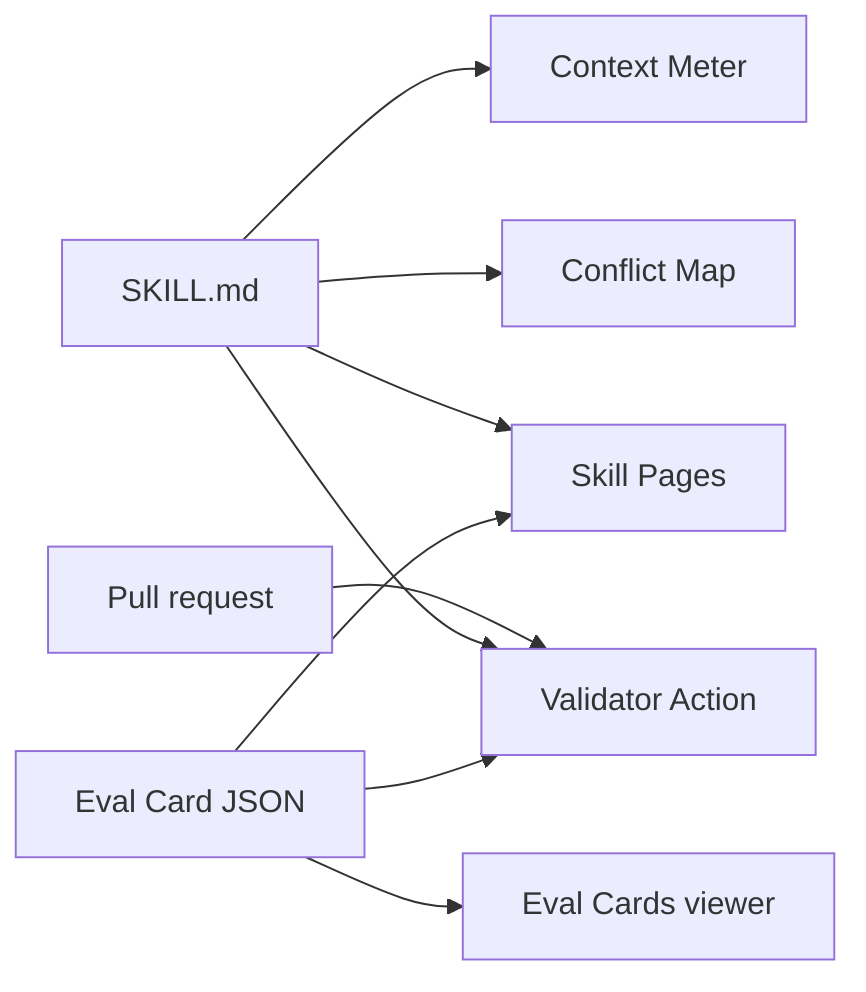

<div align="center">


<br>

**Free, open-source tools to check, measure and showcase AI agent skills.**<br>
Everything runs in your browser. Nothing is uploaded.

<br>

[](https://github.com/piyush2707/skillproof/actions/workflows/validate.yml)


[](https://github.com/piyush2707/skillproof/stargazers)

<br>

### [Open the live site](https://piyush2707.github.io/skillproof/)

[Context Meter](https://piyush2707.github.io/skillproof/meter/) ·
[Conflict Map](https://piyush2707.github.io/skillproof/conflicts/) ·
[Eval Cards](https://piyush2707.github.io/skillproof/evals/) ·
[Skill Pages](https://piyush2707.github.io/skillproof/skills/)

</div>

<br>

---

## The problem

A skill is a folder with a `SKILL.md` file that teaches an agent one task. Skills are quick to write, but it is hard to know:

- Is it **well-formed**?
- How much **context** does it use before any task starts?
- Does it **clash** with the other skills you installed?
- Is there any **evidence** that it actually helps?

Most skill repositories are collections of instructions with no proof. SkillProof adds measurable checks and visible evidence, using only GitHub and your browser.

---

## The toolkit

<table>
<tr>
<td width="50%" valign="top">

### Context Meter
Estimate how many tokens your skills use before any task starts.

[**Open →**](https://piyush2707.github.io/skillproof/meter/)

</td>
<td width="50%" valign="top">

### Conflict Map
Find skills whose descriptions overlap and may confuse an agent.

[**Open →**](https://piyush2707.github.io/skillproof/conflicts/)

</td>
</tr>
<tr>
<td width="50%" valign="top">

### Eval Cards
A JSON format and viewer for with/without-skill test results.

[**Open →**](https://piyush2707.github.io/skillproof/evals/)

</td>
<td width="50%" valign="top">

### Skill Pages
A page per example skill: cost, install steps and evidence.

[**Open →**](https://piyush2707.github.io/skillproof/skills/)

</td>
</tr>
<tr>
<td colspan="2" valign="top">

### Validator Action
A GitHub Action that checks `SKILL.md` files and eval cards on every push and pull request. It also checks that deliberately broken fixtures are rejected, so the validator itself is tested. [**View the code →**](validators/)

</td>
</tr>
</table>

---

## Try it in 30 seconds

No install. No account.

1. Open the [Context Meter](https://piyush2707.github.io/skillproof/meter/) and tap **Load sample**.
2. Paste your own `SKILL.md` and tap **Measure**.
3. Paste several skills, separated by a line of `=====`, into the [Conflict Map](https://piyush2707.github.io/skillproof/conflicts/).
4. Record test results in an [Eval Card](schema/eval-card.md) and view them on the [Eval Cards page](https://piyush2707.github.io/skillproof/evals/).

---

## How it fits together



Everything on the left is plain text in the repository. Everything on the right is either a web page in your browser or a GitHub Action.

---

## What the validator checks

The workflow in [`.github/workflows/validate.yml`](.github/workflows/validate.yml) runs on every push and pull request.

| Check | Looks at |
|---|---|
| Frontmatter | Exists, with a `name` and `description` |
| Name | Lowercase letters, numbers and hyphens only |
| Description | Long enough to be useful and says when to use the skill |
| File links | Links inside the skill point to files that exist |
| Length | Warns on very long skill bodies |
| Eval cards | Required fields, valid results and unique case ids |

Skill rules live in [`validators/rules.json`](validators/rules.json).

---

## Eval Cards

An Eval Card is a file named `<skill>.eval.json` in [`evals/`](evals/). Each case records a prompt, what a good answer needs, and the result **without** and **with** the skill.

| Result | Meaning |
|---|---|
| `pass` | The answer met the expectation |
| `partial` | Partly met |
| `fail` | Did not meet it |
| `untested` | Not run |

The `evidence_type` field says whether a card is `example`, `manual` or `automated`, so sample data is never mistaken for a real test. See the [format reference](schema/eval-card.md).

---

## Repository layout

```
skillproof/
├── docs/                 Website (GitHub Pages)
│   ├── index.html        Home page
│   ├── meter/            Context Meter
│   ├── conflicts/        Conflict Map
│   ├── evals/            Eval Cards viewer
│   ├── skills/           Skill Pages
│   └── assets/           Banner image
├── skills-examples/      Example skills
├── evals/                Eval cards
├── schema/               Eval Card format reference
├── validators/           Validator scripts and rules
├── tests/fixtures/       Broken files the validator must reject
└── .github/              Workflows and issue templates
```

---

## Honest limits

- **Token counts are estimates**, at about 4 characters per token. A real tokenizer will differ.
- **Conflict scores are word overlap.** They are a warning to review, not proof that an agent will get confused.
- **SkillProof does not run any agent.** Eval Cards record evidence that a person ran and logged.
- **Compatibility:** SkillProof reads the `SKILL.md` format (name and description in frontmatter). Support for specific agents will be listed here only after it has been tested.
- The example eval card for `hello-skill` is sample data and is labelled that way.

---

## Roadmap

- [x] Validator Action
- [x] Context Meter
- [x] Conflict Map
- [x] Eval Cards
- [x] Skill Pages
- [ ] RAG Failure Attribution skill
- [ ] RepoReel: turn a GitHub repo into a short explainer video in the browser
- [ ] More validator checks and community-submitted skills

Full details in [`ROADMAP.md`](ROADMAP.md).

---

## FAQ

<details>
<summary><b>Does SkillProof upload my skills anywhere?</b></summary>
<br>
No. The web tools run entirely in your browser. What you paste stays on your device.
</details>

<details>
<summary><b>Does it work with my agent?</b></summary>
<br>
SkillProof reads the <code>SKILL.md</code> format. It does not run any agent, so it checks your files rather than an agent's behavior. Agent-specific compatibility will be listed only after testing.
</details>

<details>
<summary><b>Why are token counts approximate?</b></summary>
<br>
They use about 4 characters per token, which is a rough rule. Different models count tokens differently, so treat the numbers as a guide for comparing skills.
</details>

<details>
<summary><b>Can I add my own skill?</b></summary>
<br>
Yes. Add a folder under <code>skills-examples/</code> with a <code>SKILL.md</code> and open a pull request. See <a href="CONTRIBUTING.md">CONTRIBUTING.md</a>.
</details>

<details>
<summary><b>Can I trust the example eval card?</b></summary>
<br>
It is labelled "example" because it is sample data showing the format, not a real test run. Real results use <code>manual</code> or <code>automated</code>.
</details>

---

## Contributing

Skills, eval cards and fixes are welcome. Read [`CONTRIBUTING.md`](CONTRIBUTING.md) first and follow the [Code of Conduct](CODE_OF_CONDUCT.md). Report vulnerabilities privately as described in [`SECURITY.md`](SECURITY.md).

If SkillProof is useful to you, a star on the repository helps others find it.

---

## License

MIT. See [`LICENSE`](LICENSE).

<br>

<div align="center">

Made by [Piyush](https://github.com/piyush2707) at **Welvox**

</div>
